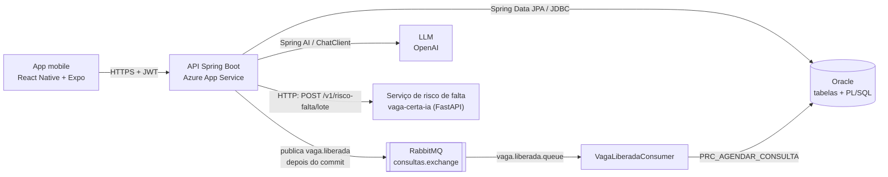
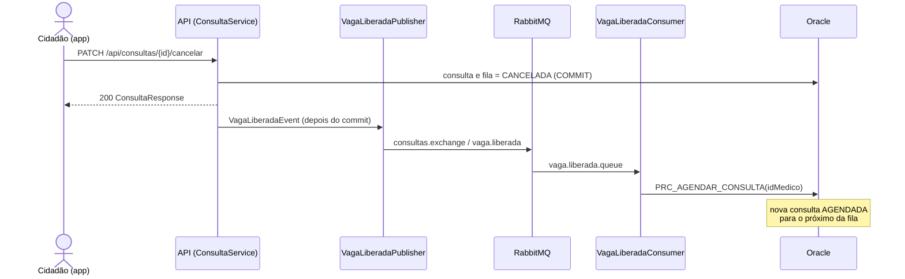
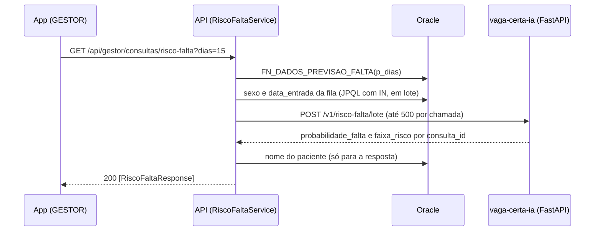

# Cadê minha consulta — API

API Java do app **Cadê minha consulta**, Global Solution FIAP 2026/2, tema **CitizenTech** (ODS 3: Saúde e bem-estar).

| | |
|---|---|
| API em produção | https://cademinhaconsulta-rm564205.azurewebsites.net |
| Swagger UI em produção | https://cademinhaconsulta-rm564205.azurewebsites.net/swagger-ui.html |
| Repositório do app mobile | https://github.com/Nicolas-Jacob/cade-minha-consulta-mobile |
| Vídeo pitch | https://youtu.be/hUzrO14MWPc |
| Vídeo da apresentação técnica | https://youtu.be/yFQxA4hCw_o |
| Contrato entre a API e o app | [docs/CONTRATO_API.md](docs/CONTRATO_API.md) |

## Equipe

| Nome | RM | Turma |
|---|---|---|
| João Victor Vendrameto | RM563665 | 2TDSPV |
| Nicolas de Oliveira Jacob | RM564205 | 2TDSPX |
| Gabriel Ambrósio Saraiva | RM566552 | 2TDSPV |
| Vinicius Romaguera Cardozo | RM562308 | 2TDSPX |
| Yuri Fuzinatto Garzoli Barreto | RM561450 | 2TDSPX |

## O problema

No SUS, cerca de 1 em cada 4 pacientes falta à consulta com especialista sem avisar. A vaga, que levou meses para sair, é desperdiçada enquanto outras pessoas seguem esperando na fila.

## A solução

- O **cidadão** acompanha pelo app as suas solicitações (fila) e consultas. Com um toque, ele confirma presença ou libera a vaga.
- Quando uma vaga é liberada, o sistema **agenda automaticamente** o próximo paciente compatível da fila.
- O **gestor** da unidade agenda pacientes da fila para médicos, acompanha as próximas consultas e registra presença ou falta.
- A **IA generativa** escreve lembretes e orientações de preparo em linguagem simples.
- Um modelo de **ML** (serviço `vaga-certa-ia`, feito por outro integrante) prevê o risco de falta das próximas consultas, e a API mostra esse risco ao gestor.

**ODS 3 (Saúde e bem-estar):** menos vagas de especialista desperdiçadas significa mais atendimentos com a mesma estrutura e menos tempo de espera na fila.

### Público beneficiado

- **Pacientes do SUS** que aguardam consulta com especialista: acompanham a fila e as consultas sem precisar ir à unidade ou ligar, e recebem orientações claras de preparo.
- **Quem está na fila**: as vagas liberadas são reaproveitadas na hora, em vez de ficarem vazias.
- **Gestores e reguladores das unidades de saúde**: agendam pela fila, registram presença e falta e, com o modelo de ML, sabem quais consultas têm mais risco de falta.

## Arquitetura



- **App mobile → API:** REST com JSON e JWT no header `Authorization: Bearer <token>`.
- **API → Oracle:** JPA para o CRUD. As regras de agendamento ficam em PL/SQL (`PKG_GS_GESTAO_CONSULTAS`, `PKG_GS_CONSULTA_DADOS`) e são chamadas com `SimpleJdbcCall`. O schema vem dos scripts de [scripts/](scripts/), nunca do Hibernate (`ddl-auto: none`).
- **API → RabbitMQ → consumer → procedure:** a realocação da vaga liberada é assíncrona (ver [Arquitetura distribuída](#arquitetura-distribuída-opção-a-rabbitmq)). Local: RabbitMQ no Docker. Produção: CloudAMQP.
- **API → LLM:** orientações da consulta com Spring AI (ver [IA generativa](#ia-generativa-spring-ai)).
- **API → serviço de risco de falta:** `RestClient` para o serviço `vaga-certa-ia` (Python/FastAPI), com timeouts e fallback para risco null. Sem `RISCO_FALTA_URL`, usa um stub (ver [Risco de falta](#risco-de-falta)).

Pacotes do código (`br.com.fiap.cademinhaconsulta`): `controller`, `service`, `repository`, `model` (entidades JPA), `dto` (records), `enums`, `exception` (`@RestControllerAdvice`), `config` (segurança, JWT, OpenAPI), `messaging` (RabbitMQ) e `risco` (cliente do modelo de ML).

## Stack

| Camada | Tecnologia |
|---|---|
| Linguagem | Java 21 |
| Framework | Spring Boot 4 (Web MVC, Data JPA, Validation, Actuator) |
| Segurança | Spring Security + JWT via OAuth2 Resource Server (JwtEncoder/JwtDecoder Nimbus, HS256), BCrypt |
| Banco | Oracle (schema e regras em PL/SQL nos scripts de `/scripts`) |
| IA | Spring AI (OpenAI) |
| Mensageria | RabbitMQ (Spring AMQP); CloudAMQP em produção |
| Documentação | springdoc-openapi (Swagger UI) |
| Deploy | Azure App Service (Linux, Java SE 21), Azure CLI |
| Outros | Lombok, Maven Wrapper |

## Como rodar localmente

### Pré-requisitos

- Java 21
- Acesso a um banco Oracle
- Docker, para o RabbitMQ (ver o passo 3). Sem o broker a API sobe normalmente, mas a vaga liberada não é realocada automaticamente.
- (Opcional) Uma chave da OpenAI. Sem ela, a API sobe e as orientações usam o texto padrão (ver [IA generativa](#ia-generativa-spring-ai)).

### 1. Criar o banco

Execute os scripts de [scripts/](scripts/) no Oracle, nesta ordem:

1. `script-bd.sql`: tabelas, constraints, sequences e triggers de ID
2. `02-triggers.sql`: triggers de auditoria e regra de data futura
3. `03-pkg-gestao-consultas.sql`: package de agendamento
4. `04-pkg-consulta-dados.sql`: package de consultas e dados para o modelo de risco
5. `05-carga-dados.sql`: carga de dados (inclui os usuários de teste)

### 2. Configurar as variáveis de ambiente

Copie o `.env.example` para `.env` na raiz do projeto e preencha os valores (ver [Variáveis de ambiente](#variáveis-de-ambiente)). O `.env` não vai para o Git. A API lê o arquivo com `spring.config.import=optional:file:.env[.properties]`.

```bash
cp .env.example .env
```

### 3. Subir o RabbitMQ

O [docker-compose.yml](docker-compose.yml) da raiz sobe só o RabbitMQ (imagem `rabbitmq:management`):

```bash
docker compose up -d
```

- AMQP: `localhost:5672`, vhost `/`, sem SSL (usuário e senha `guest`, os mesmos do `.env.example`)
- Painel de administração: http://localhost:15672 (`guest` / `guest`). Em **Queues** aparece a fila `vaga.liberada.queue`, criada pela API ao conectar.
- Para parar: `docker compose down`

### 4. Subir a API

```bash
./mvnw spring-boot:run
```

No Windows (PowerShell/CMD): `mvnw.cmd spring-boot:run`

A API sobe na porta 8080. Na primeira execução, o `SenhaHashRunner` converte para BCrypt as senhas em texto puro da carga. Isso leva alguns segundos.

### 5. Testar

- Swagger UI: http://localhost:8080/swagger-ui.html. Faça o login em `POST /api/auth/login`, copie o `token`, clique em **Authorize** e cole o token.
- Health: http://localhost:8080/actuator/health. Reflete só o banco (ver [Health check](#health-check)).
- Arquivo [test.http](test.http) com exemplos de requisições (extensão REST Client do VS Code).

### Testes automatizados

```bash
./mvnw clean package
```

Os testes são unitários e **não precisam de banco, broker nem chave de IA**:

- `OrientacaoServiceTest`: prompt da IA, fallback para o texto padrão e minimização de dados (o prompt não leva CPF, telefone, e-mail etc.).
- `TokenServiceTest`: JWT com as claims do contrato (`sub`, `id`, `credencial`), conversão para `ROLE_GESTOR` e `ROLE_CIDADAO`, rejeição de token assinado com outra chave e de segredo com menos de 32 caracteres.
- `MapeadorRiscoFaltaTest`: campos enviados ao serviço de risco (snake_case, sem null, datas `YYYY-MM-DD`, limites) e ausência de nome, CPF, telefone, e-mail e endereço no JSON.
- `HttpRiscoFaltaClientTest`: cliente HTTP do risco com `MockRestServiceServer` (sem rede): sucesso, header `X-Service-Token`, id ausente, 401/422/500/503, timeout, JSON inválido, lista vazia e lotes de 500.
- `RiscoFaltaConfigTest`: `RISCO_FALTA_URL` vazia usa o stub; preenchida usa o cliente HTTP.

## Usuários de teste

Criados pelo `05-carga-dados.sql`:

| Perfil | Login | Senha |
|---|---|---|
| GESTOR | `gestor` | `SenhaGestor2026` |
| CIDADAO | `cidadao` | `Senha123` |

## Endpoints

Papéis: **pub** = público; **logado** = qualquer usuário autenticado; **CID** = CIDADAO; **GES** = GESTOR; **dono** = o recurso (solicitação ou consulta) pertence ao usuário do token.

Todo GET de lista é paginado (`?page=0&size=10&sort=campo,asc`) e devolve `content`, `totalElements`, `totalPages`, `number` e `size`. Erros seguem o formato padrão da seção 5 do [contrato](docs/CONTRATO_API.md): `status`, `erro`, `mensagem`, `campos` (só em erro de validação), `caminho` e `timestamp`.

### Auth e usuário

| Método | Rota | Papel | Observação |
|---|---|---|---|
| POST | `/api/auth/register` | pub | Cadastra cidadão e devolve o token (201) |
| POST | `/api/auth/login` | pub | Devolve o token JWT |
| GET | `/api/usuarios/me` | logado | Dados do usuário do token |
| PUT | `/api/usuarios/me` | logado | Atualiza nome, contato e endereço |

### Catálogo

| Método | Rota | Papel | Observação |
|---|---|---|---|
| GET | `/api/especialidades` | logado | Padrão `sort=nome,asc` |
| GET | `/api/especialidades/{id}` | logado | |
| POST | `/api/especialidades` | GES | 201 |
| PUT | `/api/especialidades/{id}` | GES | |
| DELETE | `/api/especialidades/{id}` | GES | 204. 409 se estiver em uso por médico ou fila |
| GET | `/api/unidades?status=&especialidade=` | logado | Padrão `sort=nome,asc`. CID só vê ATIVO; `status` só vale para o GES. `especialidade`: só unidades com médico ATIVO dessa especialidade |
| GET | `/api/unidades/{id}` | logado | CID recebe 404 se a unidade estiver INATIVO |
| POST | `/api/unidades` | GES | 201. Grava contato e endereço. `status` opcional (padrão ATIVO) |
| PUT | `/api/unidades/{id}` | GES | Atualiza contato e endereço. `status` opcional (permite reativar) |
| DELETE | `/api/unidades/{id}` | GES | 204. Status INATIVO |
| GET | `/api/medicos?especialidade=&unidade=` | GES | Padrão `sort=nome,sobrenome,asc` |
| GET | `/api/medicos/{id}` | GES | |
| POST | `/api/medicos` | GES | 201. 409 se o CRM já existir na mesma UF. `status` opcional (padrão ATIVO) |
| PUT | `/api/medicos/{id}` | GES | Atualiza especialidades e unidades. `status` opcional (permite reativar) |
| DELETE | `/api/medicos/{id}` | GES | 204. Status INATIVO |

### Fila (solicitações de consulta)

| Método | Rota | Papel | Observação |
|---|---|---|---|
| POST | `/api/filas` | CID | 201. Prioridade 1, AGUARDANDO. 404 especialidade/unidade inexistente, 422 unidade inativa, 409 se já houver solicitação AGUARDANDO para a especialidade |
| GET | `/api/filas/minhas` | CID | Padrão `sort=dataEntrada,desc`. `posicaoEstimada` só nas AGUARDANDO |
| GET | `/api/filas/{id}` | CID dono ou GES | Outro cidadão recebe 403 |
| PUT | `/api/filas/{id}` | CID dono | Troca a unidade. Só AGUARDANDO (senão 409) |
| DELETE | `/api/filas/{id}` | CID dono | 204. Desistência: CANCELADA + data de saída. Só AGUARDANDO (senão 409) |
| GET | `/api/filas?status=&especialidade=&unidade=` | GES | Padrão `sort=prioridade,desc` e `dataEntrada,asc` (ordem real da fila) |
| PATCH | `/api/filas/{id}/prioridade` | GES | Prioridade de 1 a 5. Só AGUARDANDO (senão 409) |

### Consultas

| Método | Rota | Papel | Observação |
|---|---|---|---|
| GET | `/api/consultas/minhas?periodo=futuras` | CID | `futuras` (padrão): AGENDADA/CONFIRMADA com data futura, padrão `sort=dataHora,asc`. `historico`: o resto, padrão `sort=dataHora,desc` |
| GET | `/api/consultas/{id}` | CID dono ou GES | Outro cidadão recebe 403. O GES recebe também `paciente` |
| PATCH | `/api/consultas/{id}/confirmar` | CID dono | AGENDADA futura → CONFIRMADA (senão 409) |
| PATCH | `/api/consultas/{id}/cancelar` | CID dono | AGENDADA/CONFIRMADA futura → CANCELADA (senão 409). A fila vira CANCELADA e o evento `vaga.liberada` é publicado após o commit |
| GET | `/api/consultas/{id}/orientacoes` | CID dono ou GES | Orientações da consulta com Spring AI. `origem` IA ou PADRAO (texto padrão se a IA estiver indisponível). Ver [IA generativa](#ia-generativa-spring-ai) |

`ConsultaResponse` traz `diasAteConsulta` (dias de calendário até a consulta; 0 se já passou), o médico com nome completo e CRM, e a unidade com o endereço formatado.

### Gestor

| Método | Rota | Papel | Observação |
|---|---|---|---|
| POST | `/api/gestor/agendamentos` | GES | Body `{idMedico}`. Chama `PRC_AGENDAR_CONSULTA` e devolve 201 com a consulta criada (com `paciente`). Erros da procedure: 404 médico inexistente, 409 inativo/sem horário/fila alterada, 422 fila vazia |
| GET | `/api/gestor/consultas/proximas?dias=15` | GES | AGENDADA/CONFIRMADA nos próximos `dias` (1 a 365), padrão `sort=dataHora,asc`, com `paciente` (nome e telefone) |
| PATCH | `/api/gestor/consultas/{id}/presenca` | GES | Body `{status: "PRESENTE" \| "FALTA"}`. Só AGENDADA/CONFIRMADA com data passada (senão 409) |
| GET | `/api/gestor/consultas/risco-falta?dias=15` | GES | Exceção à paginação: array de `RiscoFaltaResponse` ordenado por data. `risco` e `nivel` vêm do serviço de IA; ficam null sem `RISCO_FALTA_URL` ou se o serviço falhar (o endpoint continua 200). Ver [Risco de falta](#risco-de-falta) |

### Infra

| Método | Rota | Papel |
|---|---|---|
| GET | `/actuator/health` | pub |
| GET | `/swagger-ui.html` | pub |

## Arquitetura distribuída: opção A (RabbitMQ)

Dentre as opções do requisito 5 de Java Advanced, escolhemos a **opção A: mensageria com RabbitMQ**. O motivo é o próprio problema: quando o cidadão libera a vaga, a resposta para ele precisa ser imediata, e a realocação para o próximo da fila pode acontecer em segundo plano, sem travar a requisição nem depender de o broker estar no ar. O fluxo:



1. `PATCH /api/consultas/{id}/cancelar` (`ConsultaService.cancelar`): numa única transação, a consulta vira CANCELADA e a solicitação (fila) dela vira CANCELADA com `data_saida`. O serviço publica um `VagaLiberadaEvent { idConsulta, idMedico, idUnidade, idEspecialidade, dataHora }` como evento do Spring.
2. `VagaLiberadaPublisher` escuta esse evento com `@TransactionalEventListener(AFTER_COMMIT)`: só envia a mensagem para a exchange `consultas.exchange` (topic, routing key `vaga.liberada`) **depois do commit**. Se a transação falhar, nada é publicado.
3. Se o RabbitMQ estiver fora do ar, o publisher só registra o erro no log. O cancelamento continua valendo; a vaga apenas não é realocada automaticamente (o gestor pode agendar pelo `POST /api/gestor/agendamentos`).
4. `VagaLiberadaConsumer` (`@RabbitListener` na fila `vaga.liberada.queue`) chama `AgendamentoService.agendarProximo(idMedico)`, que executa `PKG_GS_GESTAO_CONSULTAS.PRC_AGENDAR_CONSULTA` via `SimpleJdbcCall`. A procedure escolhe o próximo paciente compatível com o médico (prioridade + antiguidade), cria a consulta AGENDADA, tira a solicitação da fila e faz `COMMIT`.
5. Erros no consumidor não são reprocessados em loop (`default-requeue-rejected: false`): fila vazia (`-20003`) gera só um log informativo; qualquer outro erro gera log de erro e a mensagem é descartada.

As mensagens trafegam em JSON (`JacksonJsonMessageConverter`). Exchange, fila e binding são declarados pela própria API (`RabbitConfig`) ao conectar no broker.

**A API funciona sem o broker:** ela sobe normalmente, o listener tenta reconectar em segundo plano e todas as rotas continuam respondendo. Só a realocação automática da vaga fica parada até o broker voltar. Por isso o RabbitMQ não entra no health check (ver [Health check](#health-check)).

**Local e produção:** o mesmo código conecta no RabbitMQ local (Docker, porta 5672, sem SSL) e no CloudAMQP (porta 5671 com SSL e vhost da instância), só trocando as variáveis `RABBITMQ_*`.

**Limitação conhecida:** a procedure agenda no primeiro horário útil livre do médico a partir de `SYSDATE + 5` (8h–17h, seg–sex), para o paciente ter pelo menos cinco dias de aviso. Por isso, o próximo paciente nem sempre ocupa exatamente o horário que foi liberado: se a consulta cancelada era nos próximos cinco dias, aquele horário fica livre.

## IA generativa (Spring AI)

`GET /api/consultas/{id}/orientacoes` devolve uma orientação curta para o paciente sobre **aquela consulta**. A rota não é um chat livre: o texto é gerado a partir dos dados da consulta, dentro do fluxo de acompanhamento do app. Acesso: o dono da consulta ou o GESTOR. Outro cidadão recebe 403 e consulta inexistente, 404.

**Como funciona** (`OrientacaoService`, com o `ChatClient` do Spring AI):

1. O `ConsultaService.dadosParaOrientacao` valida o acesso e monta um `DadosOrientacao` só com os campos permitidos.
2. O prompt é montado a partir de templates em [src/main/resources/prompts/](src/main/resources/prompts/), não no código:
   - `orientacao-sistema.st` (mensagem de sistema): português do Brasil, linguagem simples para quem usa o SUS, tom acolhedor, no máximo 150 palavras e texto puro sem markdown (listas com "• "). Conteúdo: lembrete da consulta, o que levar (documento com foto, cartão do SUS, exames e receitas anteriores), chegar com antecedência, cuidados gerais de preparo da especialidade e o pedido de liberar a vaga pelo app se não puder ir. Restrições: **nunca diagnosticar, nunca recomendar ou alterar medicamentos e não inventar dados** (nome do médico, exames específicos etc.). Se a consulta estiver cancelada ou encerrada, só informa a situação.
   - `orientacao-usuario.st` (mensagem do usuário): os dados da consulta.
3. A resposta traz `origem` (`IA` ou `PADRAO`) e o `aviso` correspondente: "Orientação gerada por IA. Não substitui a orientação médica." ou "Orientações gerais. Não substituem a orientação médica.".

**O que vai no prompt:** especialidade e descrição, data e hora (por extenso, com o dia da semana), dias até a consulta, nome e endereço da unidade de saúde, primeiro nome do paciente e situação da consulta.

**Minimização de dados (LGPD):** o modelo **não** recebe CPF, telefone, e-mail, endereço do paciente, sobrenome nem os outros nomes do paciente, nem o nome dos pais ou o login. A garantia está no tipo: `DadosOrientacao` simplesmente não tem esses campos. O `OrientacaoServiceTest` confere que o prompt enviado não contém esses dados.

**Fallback:** a API nunca devolve 500 por causa da IA. Nestes casos ela devolve um texto padrão montado com os mesmos dados (`orientacao-padrao.st`, ou `orientacao-padrao-encerrada.st` para consulta cancelada ou passada), com `origem: "PADRAO"`, e registra o motivo no log:

- `AI_API_KEY` vazia ou não definida: a IA nem é chamada;
- erro na chamada (chave inválida, rede, limite de uso etc.);
- sem resposta em 20 s (`orientacao.timeout-segundos`; o SDK também usa `timeout: 20s` e não faz novas tentativas);
- resposta vazia.

**Limitações:** o texto é gerado por um modelo de linguagem e **pode conter erros ou imprecisões**. A IA **não diagnostica e não substitui a orientação médica**: as orientações de preparo são gerais, e o paciente deve seguir o que a unidade e o médico indicarem. O app mostra o `aviso` junto do texto. Cada chamada gera um texto novo, que não fica salvo, e consome a cota da chave da OpenAI.

## Risco de falta

`GET /api/gestor/consultas/risco-falta?dias=15` (só GESTOR) lista as consultas AGENDADA ou CONFIRMADA dos próximos `dias` (1 a 365) com o risco de falta de cada uma. Pelo contrato, é uma **exceção à paginação**: devolve um array simples de `RiscoFaltaResponse` (`idConsulta, paciente, dataHora, especialidade, risco, nivel`), ordenado pela data da consulta.

O risco vem do **serviço de IA do grupo**, o repositório `vaga-certa-ia` (Python/FastAPI, modelo `gradient_boosting`).



**Fluxo** (`RiscoFaltaService` e pacote `risco`):

1. Chama `PKG_GS_CONSULTA_DADOS.FN_DADOS_PREVISAO_FALTA(p_dias)` via `SimpleJdbcCall`. Cada linha do `SYS_REFCURSOR` vira um `DadosPrevisaoFalta`.
2. Busca o que o cursor não traz, o sexo do paciente e a entrada na fila (`ComplementoPrevisao`), em **uma** consulta JPQL com `IN` pelos ids das consultas (`ConsultaRepository.buscarComplementosPrevisao`), em blocos de até 1000 ids por causa do limite do Oracle. Sem N+1 e sem alterar o PL/SQL.
3. O `MapeadorRiscoFalta` monta um item por consulta e o valida com as regras do serviço. Um item inválido derrubaria o lote inteiro com 422, então ele não é enviado e a consulta fica com `risco` e `nivel` null (log WARN só com o id da consulta).
4. O `HttpRiscoFaltaClient` envia os itens em lotes de até 500 para `POST {RISCO_FALTA_URL}/v1/risco-falta/lote`, com o header `X-Service-Token` só se `RISCO_FALTA_TOKEN` estiver preenchida. As respostas são casadas por `consulta_id`; uma consulta sem resposta fica null.
5. Junta o nome do paciente, buscado pela própria API. O nome não vem do cursor e não vai para o serviço de IA.

**Campos enviados ao serviço** (um item por consulta):

| Campo | Origem | Observação |
|---|---|---|
| `consulta_id` | `id_consulta` do cursor | como texto |
| `idade` | `idade_paciente` do cursor (idade na data da consulta) | limitada a 0..110 |
| `genero` | `TB_GS_USUARIO.sexo_usuario` (Consulta → Usuario) | `F` ou `M`; sem valor = item não enviado |
| `data_agendamento` | `TB_GS_FILA.data_entrada` (Consulta → Fila), só a data | **aproximação**: o sistema não guarda a data de criação da consulta, então usa a entrada do paciente na fila. Se for posterior à consulta, usa a data da consulta |
| `data_consulta` | `data_consulta` do cursor, só a data | `YYYY-MM-DD` |
| `consultas_anteriores` | `qtd_presencas_historico + qtd_faltas_historico` | limitado a 1000 (cancelamentos não entram) |
| `faltas_anteriores` | `qtd_faltas_historico` | limitado a 1000 e nunca maior que `consultas_anteriores` |
| `bolsa_familia`, `hipertensao`, `diabetes`, `alcoolismo`, `deficiencia`, `sms_recebido` | sempre `false` | o banco não tem esses dados e o serviço não aceita null |

**Minimização de dados (LGPD):** só saem da API os campos acima. Nome, sobrenome, CPF, nome da mãe e do pai, telefone, e-mail, endereço, login e até o id do usuário ficam na API. O teste `MapeadorRiscoFaltaTest` garante que o JSON enviado não tem esses dados. Os logs do cliente também não registram dados pessoais, o corpo das respostas de erro (o 422 ecoa os dados enviados) nem o token.

**Risco e nível:** `risco` é a `probabilidade_falta` do modelo (0 a 1, com 4 casas; fora do intervalo = null). `nivel` é a **`faixa_risco` do próprio modelo** (`baixo` → `BAIXO`, `medio` → `MEDIO`, `alto` → `ALTO`), que já considera limiares por faixa etária. A API não recalcula o nível a partir do risco.

**Timeouts e fallback:** conexão em 3000 ms e leitura em 15000 ms (`RISCO_FALTA_CONNECT_TIMEOUT_MS` e `RISCO_FALTA_READ_TIMEOUT_MS`). Qualquer falha do serviço (conexão recusada, timeout, 401, 422, 503, 500, JSON inválido), mesmo em um só lote, gera um log WARN `Risco de falta indisponivel: <motivo>` e devolve **todas** as consultas com `risco` e `nivel` null, sem lotes parciais. O endpoint continua respondendo **200**, nunca 500. Em caso de sucesso, um log INFO registra a quantidade enviada, o tempo e o nome do modelo.

**Escolha do cliente** (`RiscoFaltaConfig`, pela variável `RISCO_FALTA_URL`):

- vazia (padrão): `StubRiscoFaltaClient`, que devolve `risco` e `nivel` null para todas as consultas;
- preenchida: `HttpRiscoFaltaClient`.

**Como rodar com o serviço de IA:** hoje o `vaga-certa-ia` roda localmente. Suba-o seguindo o README do repositório `vaga-certa-ia` (porta 8000; confira em `http://localhost:8000/health`, que não exige token) e, no `.env` da API, defina `RISCO_FALTA_URL=http://localhost:8000`. Se o serviço exigir token, use em `RISCO_FALTA_TOKEN` o mesmo valor configurado nele. O [test.http](test.http) tem o login do gestor, a chamada de risco e o health do serviço.

**Produção:** quando o serviço estiver publicado, basta definir `RISCO_FALTA_URL` (e `RISCO_FALTA_TOKEN`, se houver) no App Service e rodar o `scripts\redeploy-azure.cmd`. O service, o controller e o contrato não mudam.

## Deploy (Azure App Service)

| | |
|---|---|
| API | https://cademinhaconsulta-rm564205.azurewebsites.net |
| Swagger UI | https://cademinhaconsulta-rm564205.azurewebsites.net/swagger-ui.html |
| Health | https://cademinhaconsulta-rm564205.azurewebsites.net/actuator/health |

A API roda no **Azure App Service** (Linux, Java SE 21, plano B1), com o banco Oracle e o RabbitMQ no **CloudAMQP**.

### Como publicar

Pré-requisitos: [Azure CLI](https://aka.ms/installazurecliwindows) instalado, `az login` feito, Java 21, uma instância do CloudAMQP e o Oracle acessível a partir do Azure.

1. Crie o arquivo de ambiente de produção a partir do `.env.example`. Pode ser o próprio `.env` ou um `.env.azure`, que também fica fora do Git. Preencha com os valores de produção. No CloudAMQP: host da instância, `RABBITMQ_PORT=5671`, usuário, senha, `RABBITMQ_VIRTUAL_HOST` da instância (em geral igual ao usuário) e `RABBITMQ_SSL=true`.
2. Edite as variáveis no topo de [scripts/deploy-azure.cmd](scripts/deploy-azure.cmd): `GRUPO`, `APP` (nome **único no Azure**, vira parte da URL), `REGIAO` (`brazilsouth`), `PLANO` e `ARQUIVO_ENV` (`.env` ou `.env.azure`).
3. No cmd do Windows, na raiz do projeto:

   ```bat
   scripts\deploy-azure.cmd
   ```

O script, nesta ordem:

1. cria o grupo de recursos e o App Service Plan Linux B1;
2. cria o Web App com runtime `JAVA:21-java21` (Java SE);
3. ativa o Always On, o health check em `/actuator/health` e o modo somente HTTPS;
4. lê o arquivo de ambiente e envia as variáveis como **app settings**. Antes, confere as obrigatórias e avisa se o RabbitMQ ainda aponta para `localhost`. Os valores passam por um JSON temporário que é apagado em seguida: nenhum segredo fica no script, na tela ou na linha de comando;
5. gera o jar com `mvnw clean package` (com os testes) e publica com `az webapp deploy --type jar`;
6. imprime a URL https da API e a do Swagger.

Para publicar uma nova versão sem recriar nada (por exemplo, depois da integração do modelo de risco), use [scripts/redeploy-azure.cmd](scripts/redeploy-azure.cmd), com os mesmos `GRUPO` e `APP`. Logs em tempo real: `az webapp log tail --name <APP> --resource-group <GRUPO>`.

O plano B1 é pago. Depois da avaliação, para apagar tudo: `az group delete --name <GRUPO>`.

### Ajustes para produção

- **Porta:** `server.port: ${PORT:8080}`. No App Service Linux, a plataforma informa na variável `PORT` a porta em que o runtime Java deve escutar. Localmente, sem `PORT`, fica 8080.
- **Fuso horário:** o App Service Linux roda em **UTC**, mas o contrato usa datas no horário de Brasília, e as regras usam a hora atual (consultas futuras, data de entrada na fila, registro de presença). Por isso o `main` define `TimeZone.setDefault(America/Sao_Paulo)`. Assim, a API se comporta igual em qualquer servidor.
- **RabbitMQ:** `RABBITMQ_VIRTUAL_HOST` e `RABBITMQ_SSL` permitem usar o CloudAMQP (porta 5671 com SSL) com o mesmo código do ambiente local.
- **Segredos:** nenhum segredo tem valor padrão no `application.yml`. Banco, JWT e RabbitMQ vêm só das variáveis de ambiente. A chave da IA tem um placeholder que não é credencial e só serve para a API subir sem chave (as orientações usam o texto padrão).

### Health check

`GET /actuator/health` (público) **reflete só o banco**. O RabbitMQ fica fora (`management.health.rabbit.enabled: false`) porque a API funciona sem o broker. Se ele entrasse, uma queda do CloudAMQP marcaria a instância como doente no health check do App Service e poderia provocar reinícios sem necessidade. Com o Oracle fora do ar, o health responde `DOWN` (503).

## Variáveis de ambiente

| Variável | Descrição | Local | Produção |
|---|---|---|---|
| `DB_URL` | URL JDBC do Oracle | `jdbc:oracle:thin:@HOST:1521:SID` | |
| `DB_USERNAME` | Usuário do banco | | |
| `DB_PASSWORD` | Senha do banco | | |
| `JWT_SECRET` | Chave de assinatura do JWT (HS256), com no mínimo 32 caracteres | | |
| `AI_API_KEY` | Chave da API da OpenAI. Vazia = orientações com o texto padrão | | |
| `AI_BASE_URL` | URL base da API de IA | `https://api.openai.com/v1` | igual |
| `AI_MODEL` | Modelo de chat | `gpt-4o-mini` | igual |
| `RABBITMQ_HOST` | Host do RabbitMQ | `localhost` | host do CloudAMQP |
| `RABBITMQ_PORT` | Porta do RabbitMQ | `5672` | `5671` |
| `RABBITMQ_USERNAME` | Usuário do RabbitMQ | `guest` | usuário da instância |
| `RABBITMQ_PASSWORD` | Senha do RabbitMQ | `guest` | senha da instância |
| `RABBITMQ_VIRTUAL_HOST` | Vhost do RabbitMQ | `/` | vhost da instância |
| `RABBITMQ_SSL` | Conexão com SSL | `false` | `true` |
| `RISCO_FALTA_URL` | URL do serviço de risco de falta (`vaga-certa-ia`). Vazio = stub (risco null) | `http://localhost:8000` (ou vazio) | URL do serviço publicado (vazio enquanto ele só roda localmente) |
| `RISCO_FALTA_TOKEN` | Token enviado no header `X-Service-Token`, só se preenchido | vazio | o mesmo configurado no serviço |
| `RISCO_FALTA_CONNECT_TIMEOUT_MS` | Timeout de conexão com o serviço de risco | `3000` | igual |
| `RISCO_FALTA_READ_TIMEOUT_MS` | Timeout de leitura da resposta do serviço de risco | `15000` | igual |
| `PORT` | Porta do servidor. **Definida pelo App Service**, não vai no `.env` | (8080) | automática |

## Requisitos de Java Advanced

| Requisito | Onde está |
|---|---|
| 3+ entidades relacionadas, com CRUD e paginação | Entidades JPA em `model` (Usuario, Especialidade, Unidade, Medico, Fila, Consulta e as tabelas de contato e endereço). Medico tem `@ManyToMany` com Especialidade e Unidade; Fila tem `@ManyToOne` com Usuario, Especialidade e Unidade; Consulta, com Fila, Usuario, Medico e Unidade. CRUD completo de especialidades, unidades, médicos e filas, com GETs paginados (`Pageable`) |
| Bean Validation e tratamento de erros | DTOs (records) com `@NotBlank`, `@Size`, `@Pattern`, `@Email`, `@Past`, `@Min`/`@Max` etc. e `@Valid` nos controllers. `GlobalExceptionHandler` (`@RestControllerAdvice`) devolve o erro padrão do contrato, com `campos` nos erros de validação e os códigos do Oracle convertidos em HTTP |
| Spring Security + JWT com 2 papéis | OAuth2 Resource Server com `JwtEncoder`/`JwtDecoder` Nimbus (HS256), BCrypt, papéis `CIDADAO` e `GESTOR` (`ROLE_*`) nas rotas e regra de "dono" nos services |
| Spring AI integrado ao fluxo | Orientações da consulta com `ChatClient`, prompts em templates, minimização de dados e fallback (ver [IA generativa](#ia-generativa-spring-ai)) |
| Arquitetura distribuída | Opção A: RabbitMQ com publisher após o commit e consumer que chama a procedure (ver [Arquitetura distribuída](#arquitetura-distribuída-opção-a-rabbitmq)) |
| Documentação da API | Swagger UI com springdoc-openapi, `@Tag`/`@Operation` nos controllers e esquema Bearer para testar com o token |
| Deploy | Azure App Service com os scripts de [scripts/](scripts/) (ver [Deploy](#deploy-azure-app-service)) |

## Declaração de uso de IA

- **Claude (Anthropic):** apoio no planejamento da arquitetura, na geração de partes do código, na revisão de erros e na documentação.
- Todo o código foi revisado, testado e integrado pela equipe, que entende e responde pelo funcionamento da solução.
- A funcionalidade de IA do produto (orientações da consulta) usa o Spring AI e está descrita na seção [IA generativa (Spring AI)](#ia-generativa-spring-ai).
